<div align="center">


# RouteForge

**Cut your AI bill by sending each request to the cheapest model that can answer it well.**

</div>

RouteForge sits between your app and AI models like GPT and Claude. For every request it
predicts how likely each model is to give a good answer, then sends it to the cheapest
one that clears your quality bar. If that model fails, a backup answers. It's for teams
whose apps make many AI calls and who suspect they're overpaying for simple ones.

In a test on 161 questions it had never seen, RouteForge was **89% cheaper** than always
using the most capable model (Claude Opus 5.5). It gave good answers almost as often:
89.4% vs 90.7%, a gap within the margin of error. Typical responses were **28% faster**.

**Status:** v0.1.0, a research project. It is fully tested and benchmarked, but only on
one machine, so it isn't yet proven at production scale.

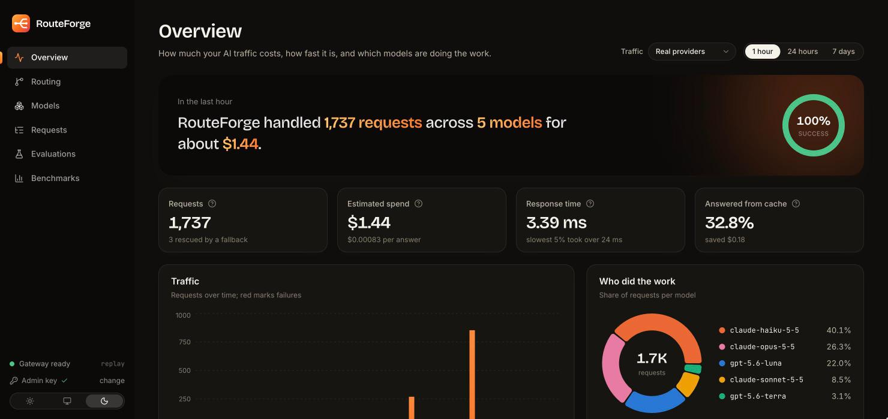

**Contents:**
[TL;DR](#tldr) ·
[See it in action](#see-it-in-action) ·
[Quick start](#quick-start) ·
[Installation](#installation) ·
[Usage](#usage) ·
[Configuration](#configuration) ·
[How it compares](#how-it-compares) ·
[How it works](#how-it-works) ·
[Results](#results) ·
[Testing and operations](#testing-and-operations) ·
[Troubleshooting](#troubleshooting) ·
[FAQ](#faq) ·
[Limitations](#limitations) ·
[Contributing](#contributing-and-support)

## TL;DR

**The problem.** Most apps send every AI request to one model. Pick a big model and you
pay premium prices for "label this headline" and "pull these fields into JSON", which a
model costing a fraction of a cent handles just as well. Pick a small model and the hard
requests come back wrong.

**The solution.** RouteForge decides per request. It has learned, from thousands of graded
answers, which models are good enough for which kinds of request, and sends each request
to the cheapest one that clears your bar. That decision takes about a third of a
millisecond.

**Why use RouteForge?**

| Feature | What it means for you |
|---|---|
| **Quality-aware routing** | Pays for a big model only when the request needs one. 89% cheaper than always using Opus in testing |
| **Drop-in for OpenAI's API** | Apps and libraries built for OpenAI work by changing one setting, the address. Behind it, RouteForge can use OpenAI, Anthropic (Claude) or local models |
| **Automatic backups** | Slow calls are cut off and retried. A failing model is taken out of rotation, and another model answers |
| **Answer cache** | Repeat questions are answered in about 11 ms instead of about 1 s, without calling a model |
| **Explainable decisions** | Every response says which model answered, why, and what it cost. The dashboard shows it all |
| **Proof, not promises** | 840 graded test questions, results with margins of error, and a CI check that blocks changes that make answers worse |

## See it in action

These are screenshots of the dashboard's **Routing** page, where you type a question and
see which model RouteForge would pick. It is running the trained router against the real
GPT-5.6 and Claude 5.5 models (in [replay mode](#modes-which-models-routeforge-uses)).
Models are listed cheapest first. The black line is the quality bar, and the first model
past it gets the request.

### Different questions go to different models

<table>
<tr>
<td width="50%">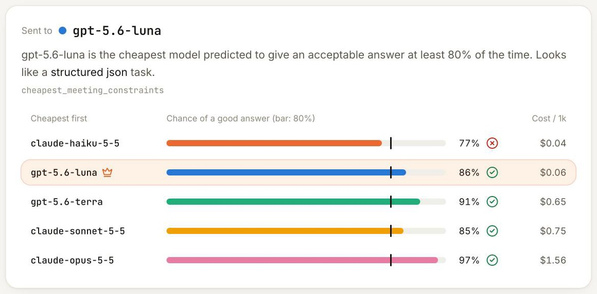</td>
<td width="50%">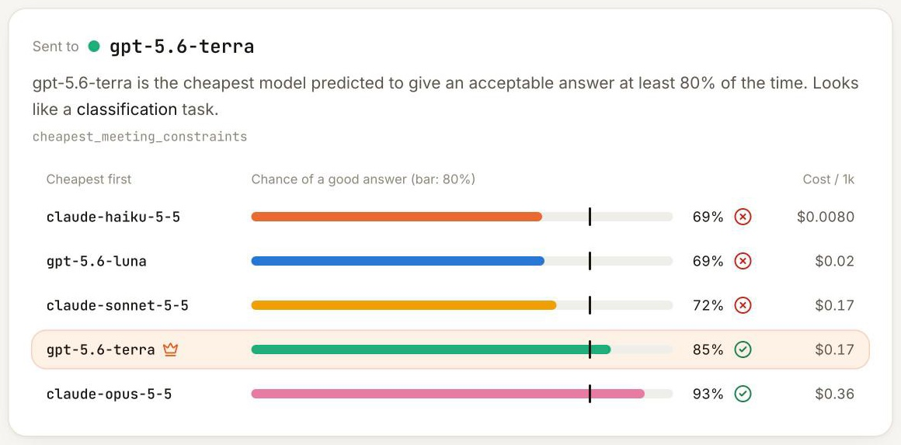</td>
</tr>
<tr>
<td><b>Fill in a form.</b> Even the cheap models are good at this. GPT-5.6 Luna is the cheapest one over the 80% bar, at about $0.06 per 1,000 requests.</td>
<td><b>Sort a headline.</b> Haiku and Luna are rated at only 69%, so the request moves up to GPT-5.6 Terra.</td>
</tr>
<tr>
<td>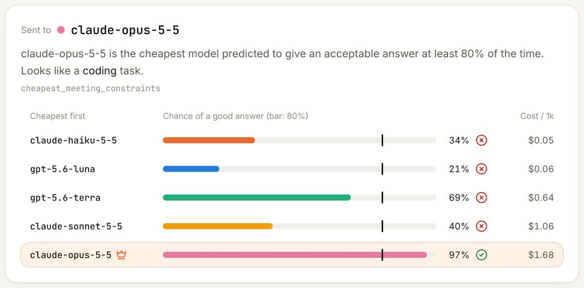</td>
<td>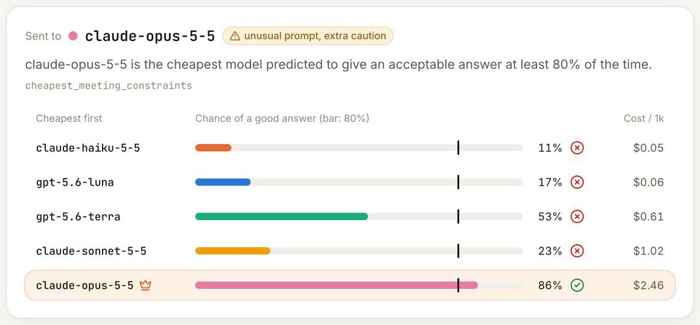</td>
</tr>
<tr>
<td><b>Write code.</b> Only Claude Opus is likely to get it right (97%). The cheaper models are rated 21–69%, so Opus is worth paying for.</td>
<td><b>Something unusual.</b> This looks nothing like the questions the router learned from. It's flagged, extra caution is applied, and only Opus clears the bar.</td>
</tr>
</table>

### The quality bar trades cost against safety

The same headline, with two different bars:

<table>
<tr>
<td width="50%">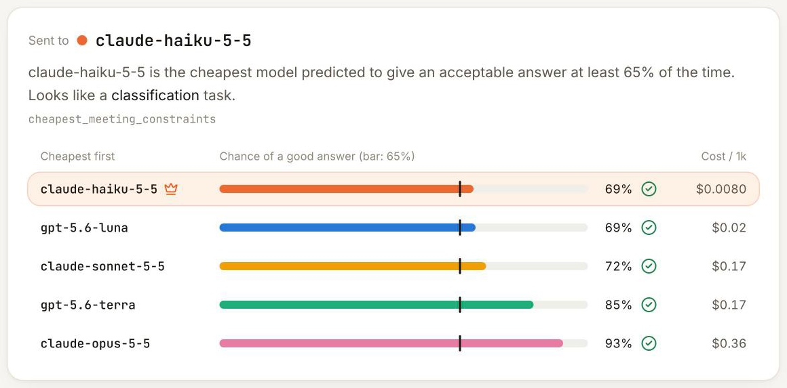</td>
<td width="50%">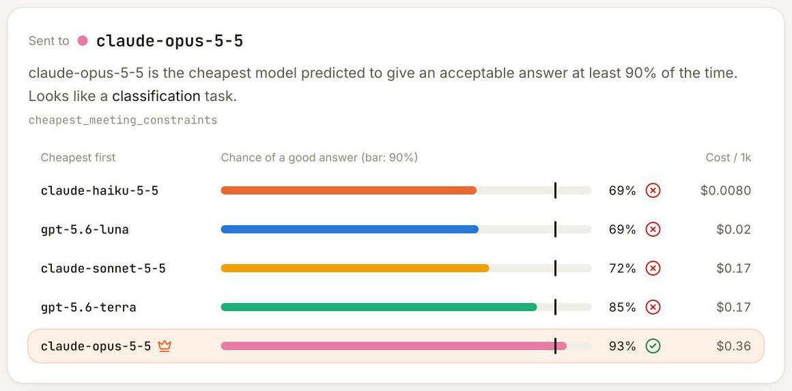</td>
</tr>
<tr>
<td><b>Bar at 65%:</b> Claude Haiku is good enough, at about $0.008 per 1,000 requests.</td>
<td><b>Bar at 90%:</b> only Claude Opus is trusted, at about $0.36 per 1,000 requests, roughly 45 times more.</td>
</tr>
</table>

### A latency budget rules out slow models

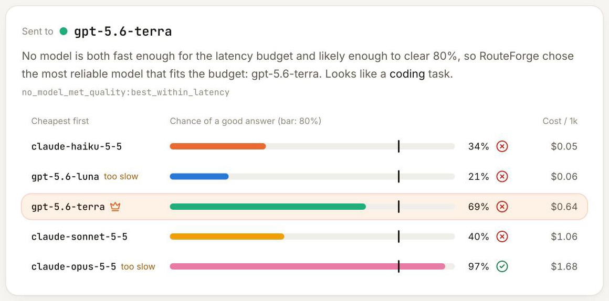

With a 1.5 s time limit, Opus (expected to take about 1.8 s) is marked **too slow**. No
model is both fast enough and likely enough to clear 80%, so RouteForge picks the most
reliable model that fits the limit: GPT-5.6 Terra.

### A backup answers when a model fails

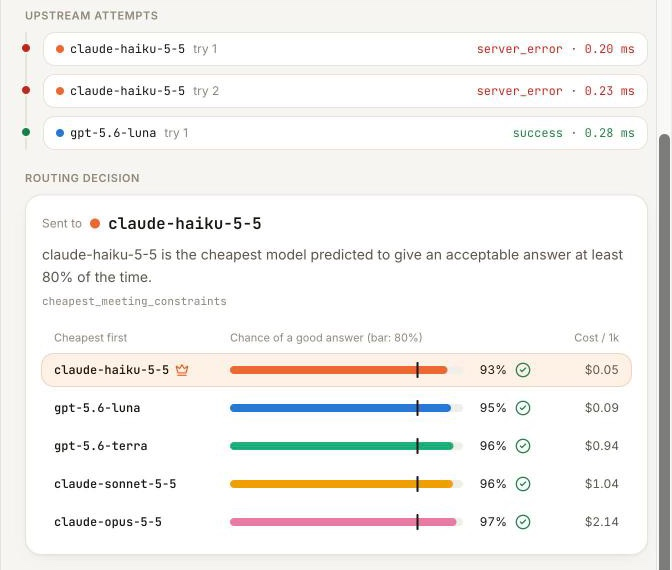

For this request the router chose Claude Haiku. We deliberately made Haiku fail, using
RouteForge's built-in fault-injection tool. RouteForge retried once, then handed the
request to the next model in line, GPT-5.6 Luna, which answered. The app got a normal
response. The **Requests** page shows each attempt and the original decision.

## Quick start

**Prerequisites:** [Docker](https://docs.docker.com/get-docker/) with Compose v2 (the
`docker compose` command) and Python 3. This starts RouteForge in **mock mode**, where
fake models stand in for real ones: no API keys and no cost. Every answer is labelled
`simulated`.

```bash
git clone https://github.com/KaavinB/Routeforge.git routeforge && cd routeforge
python3 infrastructure/scripts/init_env.py   # writes .env with generated keys (mock mode)
docker compose up --build -d                 # gateway :8000, dashboard :8080, Postgres, Redis
until curl -sf localhost:8000/ready > /dev/null; do sleep 2; done

export ROUTEFORGE_KEY=$(grep ^ROUTEFORGE_BOOTSTRAP_CLIENT_KEY .env | cut -d= -f2)
curl -s localhost:8000/v1/chat/completions \
  -H "Authorization: Bearer $ROUTEFORGE_KEY" -H "Content-Type: application/json" \
  -d '{"model": "routeforge-auto", "messages": [{"role": "user", "content": "Say hello"}]}'
```

You should get a response like this:

```json
{"id": "chatcmpl-45a9…", "object": "chat.completion", "model": "mock-small",
 "choices": [{"index": 0, "message": {"role": "assistant", "content": "[SIMULATED mock-small] policy model inference …"}, "finish_reason": "stop"}],
 "usage": {"prompt_tokens": 8, "completion_tokens": 50, "total_tokens": 58},
 "routeforge": {"strategy": "heuristic", "selected_model": "mock-small", "cache": "nondeterministic", "cost_usd": 2.58e-05, "fallback_used": false, "simulated": true}}
```

Then open http://localhost:8080 and paste the admin key into the dashboard's sidebar. The
key is `ROUTEFORGE_BOOTSTRAP_ADMIN_KEY` in `.env`.

## Installation

Runs anywhere Docker runs. It was developed and benchmarked on macOS (Apple silicon).

**Docker Compose (recommended).** The [Quick start](#quick-start) above is the whole
install: it builds and starts the gateway, dashboard, PostgreSQL 17 and Redis 7.4.

**Make shortcuts.** The same thing with fewer keystrokes. `make help` lists every target.

```bash
make up      # generate .env if needed, then build and start everything
make logs    # follow the gateway's logs
make down    # stop everything
```

**Development setup.** For working on the code you also need Python 3.12–3.13,
[uv](https://docs.astral.sh/uv/) and Node.js 22. This installs local dependencies and runs
the dashboard with live reload against the running gateway.

```bash
make install    # uv sync (Python) + npm ci (dashboard)
make up         # gateway, Postgres and Redis in Docker
make frontend   # dashboard with live reload at http://localhost:5173
```

Check it's running: `curl localhost:8000/health` returns `{"status":"ok","version":"0.1.0"}`.

## Usage

The examples below run against the Quick start setup (mock mode), so the model names and
answers you see are the simulated ones.

### Call RouteForge from Python

Use OpenAI's official Python library, pointed at RouteForge instead of OpenAI. Set the
model to `routeforge-auto` to let RouteForge choose. RouteForge's own settings go in
`extra_body`.

```python
# pip install openai
import os
from openai import OpenAI

client = OpenAI(base_url="http://localhost:8000/v1", api_key=os.environ["ROUTEFORGE_KEY"])

resp = client.chat.completions.create(
    model="routeforge-auto",  # let RouteForge pick the model
    messages=[{"role": "user", "content": "Write a Python function that reverses a string."}],
    extra_body={"routeforge": {"quality_threshold": 0.8, "latency_budget_ms": 3000}},
)

print(resp.choices[0].message.content)
meta = resp.model_extra["routeforge"]
print(f"answered by {resp.model} via {meta['strategy']} for ${meta['cost_usd']:.6f} (cache: {meta['cache']})")
```

Output (mock mode):

```text
[SIMULATED mock-premium] evaluation metric inference cache quality fallback …
answered by mock-premium via heuristic for $0.000938 (cache: nondeterministic)
```

### Stream the answer as it's written

Set `stream=True` to receive the answer piece by piece instead of waiting for all of it.
Adding `include_usage` also reports the token count at the end.

```python
import os
from openai import OpenAI

client = OpenAI(base_url="http://localhost:8000/v1", api_key=os.environ["ROUTEFORGE_KEY"])

stream = client.chat.completions.create(
    model="routeforge-auto",
    messages=[{"role": "user", "content": "Explain DNS in two sentences."}],
    stream=True,
    stream_options={"include_usage": True},
)
for chunk in stream:
    if chunk.choices and chunk.choices[0].delta.content:
        print(chunk.choices[0].delta.content, end="", flush=True)
    if chunk.usage:
        print(f"\n[{chunk.usage.total_tokens} tokens, model {chunk.model}]")
```

Output (mock mode):

```text
[SIMULATED mock-small] latency trace provider response evaluation metric …
[64 tokens, model mock-small]
```

### Control how models are chosen

There are three ways:

1. Name a routing policy in the model field, as `routeforge-<policy>`.
2. Keep `routeforge-auto` and change the settings for one request.
3. Name an exact model from `GET /v1/models`. That model is always used, never swapped.

The policies are described under [Configuration](#configuration).

```python
import os
from openai import OpenAI

client = OpenAI(base_url="http://localhost:8000/v1", api_key=os.environ["ROUTEFORGE_KEY"])
messages = [{"role": "user", "content": "Classify: 'Stocks rallied on Friday' -> World, Sports, Business or Sci/Tech?"}]

# 1. Pick a policy by model name: routeforge-<strategy>
cheap = client.chat.completions.create(model="routeforge-economy", messages=messages, temperature=0)

# 2. Or keep routeforge-auto and override per request
safe = client.chat.completions.create(
    model="routeforge-auto",
    messages=messages,
    temperature=0,
    extra_body={"routeforge": {"strategy": "heuristic", "quality_threshold": 0.95, "cache": False}},
)

# 3. Or pin an exact model id from GET /v1/models (never silently replaced)
pinned = client.chat.completions.create(model="mock-premium", messages=messages, temperature=0)

for name, r in [("economy", cheap), ("heuristic", safe), ("pinned", pinned)]:
    print(f"{name:10} -> {r.model}")
```

Output (mock mode):

```text
economy    -> mock-economy
heuristic  -> mock-economy
pinned     -> mock-premium
```

### See which model answered and what it cost

Every response includes `x-routeforge-*` headers. The same details are in the response
body under `routeforge`.

```bash
curl -s -o /dev/null -D - localhost:8000/v1/chat/completions \
  -H "Authorization: Bearer $ROUTEFORGE_KEY" -H "Content-Type: application/json" \
  -d '{"model": "routeforge-auto", "temperature": 0,
       "messages": [{"role": "user", "content": "Classify: \"Stocks rallied on Friday\" -> World, Sports, Business or Sci/Tech?"}]}' \
  | grep -i '^x-routeforge'
# x-routeforge-model: mock-economy
# x-routeforge-strategy: heuristic
# x-routeforge-cache: miss
# x-routeforge-cost-usd: 0.00001920
# x-routeforge-fallback: false
# x-routeforge-simulated: true
# x-routeforge-trace-id: 582459f2b687150098e72faeda440ec8
```

### Handle errors

Errors use the same format as OpenAI's, so the OpenAI library's error types work as usual.
RouteForge rejects features it doesn't support with HTTP 400 instead of quietly ignoring
them. These include asking for several answers at once, tool calling and images. When a
model fails, RouteForge retries and tries other models first. An error only reaches you
when all of them fail.

```python
import os
import openai
from openai import OpenAI

client = OpenAI(base_url="http://localhost:8000/v1", api_key=os.environ["ROUTEFORGE_KEY"], max_retries=2)

try:
    client.chat.completions.create(
        model="routeforge-auto",
        messages=[{"role": "user", "content": "hi"}],
        n=2,  # unsupported: RouteForge rejects it instead of silently dropping it
    )
except openai.BadRequestError as e:
    print("400 bad request:", e.body["message"] if isinstance(e.body, dict) else e)
except openai.RateLimitError:
    print("429: over this key's rate limit; back off and retry")
except openai.AuthenticationError:
    print("401: missing or revoked API key")
except openai.APIStatusError as e:
    print(f"{e.status_code}: upstream models failed after retries and fallbacks")
```

Output:

```text
400 bad request: Value error, n > 1 is not supported by RouteForge (n)
```

### Preview a decision without calling a model

This admin endpoint needs the admin key. It runs the decision without calling any model
and shows each candidate's predicted quality, cost and speed. The dashboard's **Routing**
page is built on it.

```bash
export ADMIN_KEY=$(grep ^ROUTEFORGE_BOOTSTRAP_ADMIN_KEY .env | cut -d= -f2)
curl -s -G localhost:8000/api/analytics/routing/preview \
  -H "Authorization: Bearer $ADMIN_KEY" \
  --data-urlencode "prompt=Write a Python function that checks if a number is prime." \
  --data-urlencode "quality_threshold=0.8" \
  | python3 -c "import json,sys; d=json.load(sys.stdin); print(d['selected_model'], d['reason'], d['fallback_chain'])"
# mock-premium task=code;level=3 ['mock-medium', 'mock-small', 'mock-economy']
```

### Give your app its own API key

Create a key with the admin key. The new key is shown once; RouteForge stores only a
scrambled (hashed) copy. You can cap each key's requests per minute (`rate_limit_rpm`) and
how many requests it runs at once (`max_concurrency`). To revoke a key, call
`DELETE /api/admin/keys/{id}`.

```bash
curl -s localhost:8000/api/admin/keys \
  -H "Authorization: Bearer $ADMIN_KEY" -H "Content-Type: application/json" \
  -d '{"name": "my-app", "role": "client", "rate_limit_rpm": 120}'
# {"id": "...", "key": "rf-...", "prefix": "...", "role": "client", "tenant": "default", "rate_limit_rpm": 120, "max_concurrency": null}
```

## Configuration

### Routing policies

| Policy | How it picks a model |
|---|---|
| `learned` | Predicts each model's chance of a good answer and picks the cheapest above the bar. Needs a trained router: use replay or a paid mode, not mock |
| `heuristic` | Hand-written rules: harder-looking tasks (code, maths) go to bigger models |
| `premium` | Always the most capable model |
| `economy` | Always the cheapest model |
| `random` | Any model, at random. A baseline for comparison |

### Per-request settings

Pass these as `extra_body={"routeforge": {...}}` in the OpenAI library, or as a
`"routeforge": {...}` field in the JSON body.

| Option | Type | Default | What it does |
|---|---|---|---|
| `strategy` | string | `ROUTEFORGE_DEFAULT_STRATEGY` | Which policy to use for this request |
| `quality_threshold` | number, 0–1 | `0.8` | The quality bar. 0.8 means "only use a model predicted to answer well at least 80% of the time" |
| `latency_budget_ms` | number | none | Skip models expected to take longer than this |
| `cache` | boolean | on | `false` skips the answer cache. Only requests with `temperature: 0` are ever cached |
| `tags` | list of strings | none | Up to 8 labels of your own |

### Server settings

Set these in `.env` or as environment variables, then run `docker compose up -d backend`.
The main ones:

| Variable | Default | What it does |
|---|---|---|
| `ROUTEFORGE_MODE` | `mock` | Which models to use (see the modes table below) |
| `ROUTEFORGE_DEFAULT_STRATEGY` | `heuristic` | The policy used by `routeforge-auto` |
| `ROUTEFORGE_DEFAULT_QUALITY_THRESHOLD` | `0.8` | The default quality bar |
| `ROUTEFORGE_ROUTER_ARTIFACT_PATH` | empty | The trained router to load (needed for `learned`) |
| `ROUTEFORGE_DEFAULT_RATE_LIMIT_RPM` | `600` | Requests per minute allowed per API key |
| `ROUTEFORGE_CACHE_ENABLED` | `true` | Turns the answer cache on or off |
| `ROUTEFORGE_LOG_PROMPTS` | `false` | Whether prompt and answer text is stored (off: only metadata is kept) |
| `OPENAI_API_KEY`, `ANTHROPIC_API_KEY` | empty | Provider keys for the paid modes |

The full list is in [`backend/app/core/config.py`](backend/app/core/config.py) and
[`.env.example`](.env.example).

### Modes: which models RouteForge uses

| Mode | Models | What you need |
|---|---|---|
| `mock` (default) | 4 fake models | nothing |
| `replay-latest` | real answers recorded from the latest models, played back | the recordings (included) |
| `hosted-latest` | gpt-5.6-luna/terra, claude-haiku/sonnet/opus-5-5 | OpenAI and Anthropic API keys (paid) |
| `hosted` | gpt-4.1-nano/mini, claude-haiku/sonnet-5-5 (older set) | same keys; router `router-hosted-2026-10-11` |
| `local` | llama3.2:1b, qwen2.5:3b/7b on your machine via Ollama | `ollama pull llama3.2:1b qwen2.5:3b qwen2.5:7b` |

**Try real model answers for free with replay mode.** It plays back answers recorded
from the real GPT-5.6 and Claude 5.5 models, and uses the trained router. It can only
answer questions it has recordings for, so this example sends a question from the test
set:

```bash
ROUTEFORGE_MODE=replay-latest \
ROUTEFORGE_ROUTER_ARTIFACT_PATH=/app/router_training/artifacts/router-latest-2026-10-11 \
ROUTEFORGE_REPLAY_RECORDINGS_PATH=/app/router_training/data/collections/latest-2026-10-11/outputs.jsonl \
ROUTEFORGE_DEFAULT_STRATEGY=learned \
docker compose up -d backend
until curl -sf localhost:8000/ready > /dev/null; do sleep 2; done

python3 - <<'EOF'
import json, os, urllib.request

case = next(json.loads(l) for l in open("router_training/datasets/data/routeforge-bench-v1/cases.jsonl")
            if json.loads(l)["split"] == "test")
body = {"model": "routeforge-learned", "messages": case["messages"], "temperature": 0, "max_tokens": case["max_tokens"]}
req = urllib.request.Request("http://localhost:8000/v1/chat/completions", json.dumps(body).encode(),
                             {"Authorization": f"Bearer {os.environ['ROUTEFORGE_KEY']}", "Content-Type": "application/json"})
resp = json.load(urllib.request.urlopen(req))
print(case["category"], "->", resp["model"], "|", resp["choices"][0]["message"]["content"][:80])
EOF
# classification -> claude-haiku-5-5 | World
```

**Use real providers.** This calls OpenAI and Anthropic, which **costs money**:

```bash
export OPENAI_API_KEY=sk-... ANTHROPIC_API_KEY=sk-ant-...
ROUTEFORGE_MODE=hosted-latest \
ROUTEFORGE_ROUTER_ARTIFACT_PATH=/app/router_training/artifacts/router-latest-2026-10-11 \
ROUTEFORGE_DEFAULT_STRATEGY=learned \
docker compose up -d backend
```

## How it compares

How do you choose a model without RouteForge? Usually you pick one and use it for
everything. Here is how each option did on the same 161 unseen questions, with real
models and real API calls:

| Approach | Good answers | Cost per 1,000 requests | Typical response |
|---|---|---|---|
| Always the most capable model (Opus 5.5) | 90.7% | $2.99 | 1.53 s |
| Always the cheapest model | 85.7% | $0.08 | 1.17 s |
| Hand-written rules ("rule of thumb") | 87.6% | $1.52 | 1.12 s |
| A random model each time | 90.1% | $1.09 | 1.16 s |
| **RouteForge learned router** | **89.4%** | **$0.32** | **1.10 s** |

Differences of a few points in "good answers" are within the margin of error on 161
questions. The cost differences are not. The learned router matches the quality of the
expensive options at a fraction of the price. The cheapest model alone is cheaper still,
but gets noticeably more answers wrong.

## How it works

### Design principles

1. **Quality first, then price.** RouteForge never picks a model below your quality bar to
   save money. If no model clears the bar, it picks the one most likely to answer well.
2. **No silent surprises.** Unsupported options are rejected, not ignored. A model you
   name explicitly is never swapped out. Simulated data is always labelled as simulated.
3. **Bend, don't break.** If the cache's database (Redis) goes down, requests still go
   through, just without caching. A failing model is benched and a backup answers.
4. **Every claim has a receipt.** Each number in this README comes from a saved test run.
   CI blocks changes that make answers worse.
5. **Spending is capped.** Tools that call paid APIs refuse to run without a budget, and
   stop before exceeding it.

### How the router picks a model

For each model, RouteForge estimates three things: the chance it answers well, what it
will cost, and how long it will take. It knocks a safety margin off each model's chance
of answering well, a bigger one for unusual prompts. Then it picks the cheapest model
that still clears your quality bar and fits your time limit. If none does, it picks the
model most likely to answer well.

The same rule in symbols, for a request *q* and each available model *m*:

```text
p_m     = calibrated P(acceptable | features(q), task(q), m)       # per-model logistic regression
cost_m  = in_tokens · price_in(m) + E[out_tokens | m, task] · price_out(m)
lat_m   = ttft_m + a_m · in_tokens + b_m · E[out_tokens]           # least squares prior × online EWMA

choose  argmin_m cost_m   subject to   p_m − margin_m ≥ τ   and   lat_m ≤ budget
else    the most likely-acceptable model within budget (quality over latency if none fits)
```

`τ` is the quality bar. `margin_m` is how far that model's past predictions were off,
plus extra for prompts unlike the training data. On this test set, the router mostly
learned *what kind of task* each request is, rather than how hard it is; see
[docs/EVALUATION.md](docs/EVALUATION.md).

### The parts

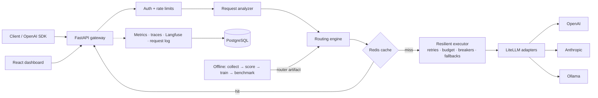

1. A request comes in and is checked (API key, rate limit) and analysed.
2. The router picks a model.
3. If the same question was answered before, the stored answer is returned straight away.
4. Otherwise the request goes to the chosen model, with retries and backups if it fails.
5. Everything is logged for the dashboard and monitoring.

The router itself is trained offline and loaded at startup. RouteForge is built with
Python, FastAPI, PostgreSQL, Redis, scikit-learn and React. More detail:
[architecture](docs/ARCHITECTURE.md),
[why each design choice was made](docs/DESIGN_DECISIONS.md), [security](docs/SECURITY.md).

## Results

Every number below comes from a saved test run in `benchmarks/results/`, together with the
exact code version and settings used. Costs are estimates from public prices. Ranges in
brackets are 95% confidence intervals: the true value is very likely inside them.

| Test | Result |
|---|---|
| **Routing with real models** (161 unseen questions) | **89% cheaper** than always using Claude Opus 5.5 [82–94%]. Good answers 89.4% vs 90.7%, a gap within the margin of error. Typical response 1.1 s vs 1.5 s |
| Routing, replayed answers | Cheaper than always using Sonnet or Terra, with at least the same quality (77.5% cheaper than Sonnet). Beats the random and rule-based policies. 3.7 points more good answers than always using the cheaper Haiku [+0.6, +7.5]. Can't reach Opus's 92.5% |
| Routing, older model set | 92.5% cheaper than always using Sonnet, with 2.5 points fewer good answers, but **no clear win** over just always using Haiku 5.5 |
| Answer cache | Repeat questions answered in 11 ms instead of about 1.1 s, without calling a model |
| Capacity | One server process handles **854 requests per second** with learned routing (1,334 without); 95% of requests finish within 35 ms; no errors with 100 clients at once. Measured with instant fake models, so this is RouteForge's own speed, not the AI models' |
| Failure handling | All **370** requests hit by deliberately injected failures still got an answer, using at most 4 model calls each |
| Routing overhead | Choosing a model takes **0.32 ms**, about 1 ms extra per request overall |
| Quality check in CI | Catches every simulated 10-point quality drop and flags every drop of 3 points or more, with no false alarms |
| AI graders | Two AI graders (GPT-4.1 and Claude Fable 5.1) agree on 91.7% of answers. Much of that agreement is what you'd expect by chance (Cohen's κ = 0.31); GPT-4.1 grades more leniently |

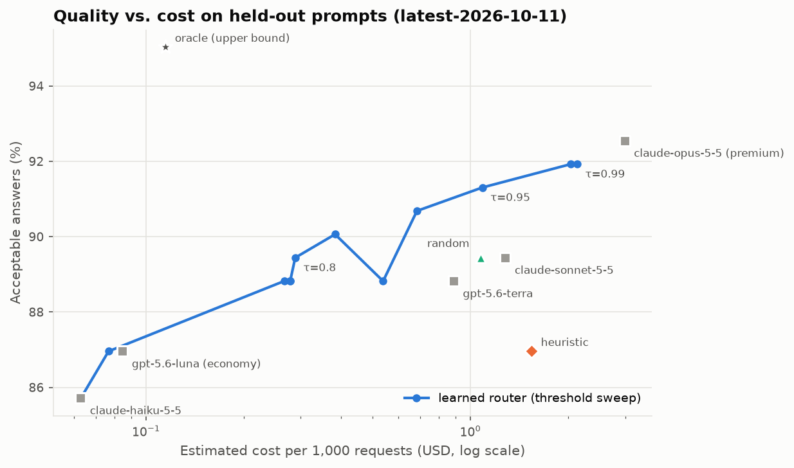

*Each dot is a strategy answering the same questions. Higher means more good answers;
further left means cheaper. The line shows the learned router at different quality bars.*

Every result can also be browsed on the dashboard's **Benchmarks** page:

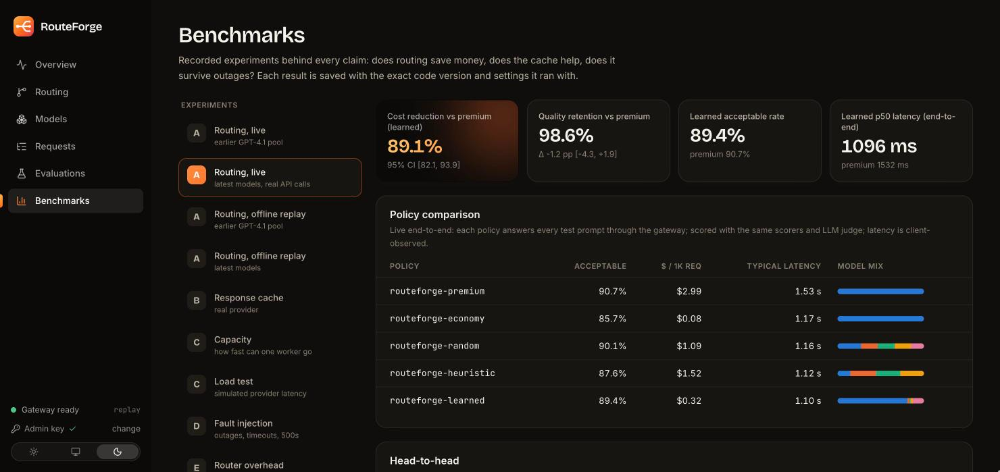

Building and testing the whole project cost **$9.36** in AI usage fees. Full write-up:
[docs/BENCHMARKS.md](docs/BENCHMARKS.md).

## Testing and operations

### Compare routing policies on the test questions

This sends the held-out test questions, which the router never saw during training,
through RouteForge with the cache turned off, and grades every answer. Results also appear
on the dashboard's **Evaluations** page.

```bash
curl -s localhost:8000/api/evaluations/run \
  -H "Authorization: Bearer $ADMIN_KEY" -H "Content-Type: application/json" \
  -d '{"targets": ["routeforge-heuristic", "routeforge-premium"], "split": "test", "limit": 20}'
sleep 10
curl -s "localhost:8000/api/evaluations/results?limit=2" -H "Authorization: Bearer $ADMIN_KEY" \
  | python3 -c "import json,sys; [print(r['target'], r['status'], r['summary'] and r['summary']['overall']['acceptable_rate']) for r in json.load(sys.stdin)['runs']]"
# routeforge-premium done 0.0
# routeforge-heuristic done 0.0
```

In mock mode the grades are 0, because the answers are fake. Use replay or a paid mode for
real numbers.

### Train a new router

These steps ask every model every question, grade the answers, and train a new router.
Steps that cost money won't run unless you set a spending cap with
`ROUTEFORGE_PAID_BUDGET_USD`. They stop before going over it and log every charge in
`benchmarks/results/spend_ledger.jsonl`.

```bash
make dataset            # build routeforge-bench-v1 (public samples + synthetic JSON tasks)
make validate-dataset   # score every reference answer: 720/720 pass
make collect REGISTRY=config/models/hosted-latest.yaml   # every prompt × every model (paid, budget-capped)
make score  COLLECTION=latest-2026-10-11                 # deterministic scorers, sandboxed code, LLM judge
make train  COLLECTION=latest-2026-10-11                 # calibrated router artifact
make replay             # Benchmarks A + F (offline, free)
make regression-suite   # Benchmark G (free)
```

Where the questions come from, how answers are graded, and how test questions are kept out
of training: [docs/EVALUATION.md](docs/EVALUATION.md).

### Monitor it

This adds three monitoring tools: Prometheus (:9090) collects the numbers, Grafana (:3000)
charts them, and Jaeger (:16686) traces each request step by step. The raw numbers are
always available at `localhost:8000/metrics`.

```bash
ROUTEFORGE_OTEL_EXPORTER_ENDPOINT=http://jaeger:4318 docker compose --profile observability up -d
curl -s localhost:8000/metrics | grep -m3 '^routeforge_'
```

### Run the tests

```bash
make lint typecheck     # ruff + mypy --strict
make test               # 89 unit / API / failure-injection tests (SQLite + fakeredis, mock providers)
docker compose up -d postgres redis && \
  ROUTEFORGE_IT_PG_ADMIN_URL=postgresql+asyncpg://routeforge_owner:<POSTGRES_PASSWORD>@localhost:5432/postgres \
  make test-integration # 5 tests against real PostgreSQL (Alembic schema) and Redis
make coverage           # 82% line coverage of backend/app
cd frontend && npm test # 7 dashboard tests
```

GitHub runs these on every push to `main` and every pull request, without any AI provider
keys, so testing never costs money.

## Troubleshooting

**`Bind for 127.0.0.1:5432 failed: port is already allocated`** (or `:6379`)
Another PostgreSQL or Redis is already using that port. Stop it, or change the left-hand
port under `ports:` for `postgres` or `redis` in `docker-compose.yml`.

**`password authentication failed for user "routeforge_owner"`** (the `migrate` step fails)
A database left over from an earlier run was created with different passwords than your
current `.env`. Restore the old `.env`, or wipe RouteForge's database with
`docker compose down -v`. That deletes its stored request history.

**Dashboard says "You're not signed in", or the API says `Missing API key`**
Paste `ROUTEFORGE_BOOTSTRAP_ADMIN_KEY` from `.env` into the dashboard sidebar. API calls
need the header `Authorization: Bearer <key>`.

**`Unknown routing strategy 'learned'`**
Mock mode has no trained router. Switch to replay or a paid mode with
`ROUTEFORGE_ROUTER_ARTIFACT_PATH` set (see [Modes](#modes-which-models-routeforge-uses)),
or use another policy.

**`The upstream model rejected the request as invalid.`** (in replay mode)
Replay mode only has answers for the benchmark questions. Send one from
`router_training/datasets/data/routeforge-bench-v1/cases.jsonl`, as in the replay example.

**`Rate limit exceeded for this API key.`** (HTTP 429)
Each key may make 600 requests per minute by default. Raise
`ROUTEFORGE_DEFAULT_RATE_LIMIT_RPM`, or [create a key](#give-your-app-its-own-api-key) with
a higher `rate_limit_rpm`.

## FAQ

**Does it work with languages other than Python?**
Yes. It's a plain HTTP API in the same format as OpenAI's, so any OpenAI client library
(JavaScript, Go, Java and others) works once you change its base URL. So does `curl`.

**Does RouteForge store my prompts?**
Not by default. The request log keeps metadata (model, cost, timing, tokens) and a
fingerprint of the messages, not the text. Turning on `ROUTEFORGE_LOG_PROMPTS` changes
that. See [docs/SECURITY.md](docs/SECURITY.md).

**What does it cost to run?**
RouteForge itself is free to run. Mock and replay modes make no paid calls. In the hosted
modes you pay OpenAI and Anthropic their normal prices, and the dashboard shows the
running estimate.

**Will I save 89% on my traffic?**
Not necessarily. That figure is from one test set. Savings depend on how many of your
requests a cheaper model can handle. Run an [evaluation](#compare-routing-policies-on-the-test-questions)
on prompts like yours to find out.

**Can I add my own models?**
Yes. Copy a file in `config/models/` (for example `hosted-latest.yaml`), list your models
with their prices and tiers, set `ROUTEFORGE_MODE` to the new file's name, and rebuild
with `docker compose up --build -d backend` (model files are built into the image). The
rule-based, premium, economy and random policies work right away. The learned router predicts
quality per model, so it has to be [retrained](#train-a-new-router) on the new set.

**Does it slow requests down?**
Barely. Choosing a model takes about 0.3 ms, and the gateway adds about 1 ms per request
in total.

## Limitations

- **One test set of 161 questions.** Differences of a few points can't be told apart from
  chance. Each task type uses the same instructions every time, so recognising the task is
  easier here than with real traffic. Prompts that look unfamiliar are sent to safer
  models.
- **The router mostly learned which model is good enough for each type of task.** Signals
  about how hard a particular question is added little.
- **Grading isn't perfect.** Some reference answers in the public trivia dataset (NQ-open)
  are wrong or incomplete, and summaries are graded by a lenient AI grader.
- **Costs are estimates** from public prices, not invoices. Speeds were measured on one
  laptop, in one region.
- **Running several copies of RouteForge:** each copy tracks failing models and load on
  its own. Only rate limits are shared.

**When not to use RouteForge:**

- You need tool calling, images or several answers per request. These are rejected.
- Nearly all your requests genuinely need the strongest model. There's little to save.
- Your requests look nothing like the seven task types in the test set (classification,
  extraction, quick facts, JSON, maths, coding, summaries). The learned router will play
  it safe and save less until you retrain it on your own data.

Next up: learning from real-world feedback, better ways to judge how hard a question is,
choosing between quick and deep-thinking modes of the same model, and sharing
failing-model status across copies.

## Contributing and support

Questions and bug reports: [open an issue](https://github.com/KaavinB/Routeforge/issues).
Pull requests are welcome. Before opening one, run `make lint typecheck test` (and
`cd frontend && npm test` for dashboard changes). If you change routing, include an
evaluation run showing its effect on cost and quality.
