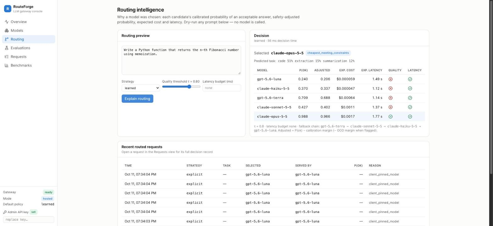
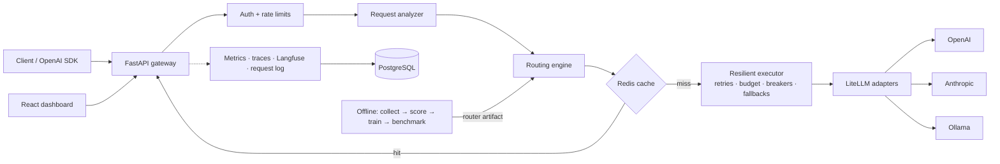
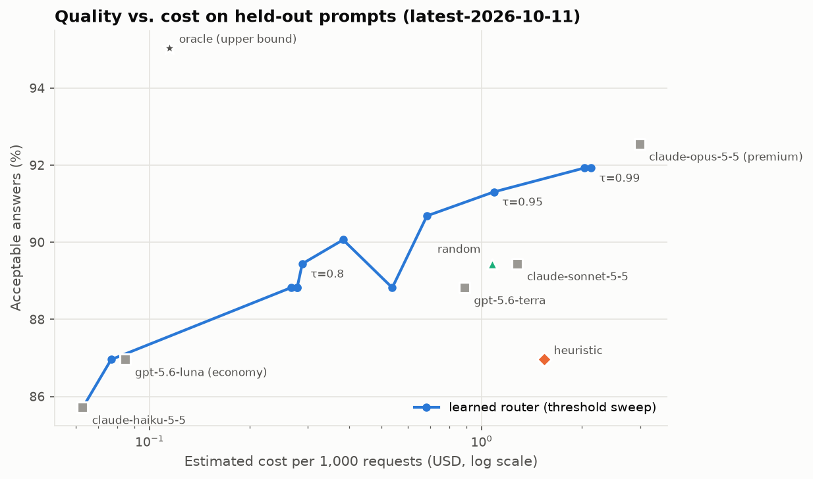
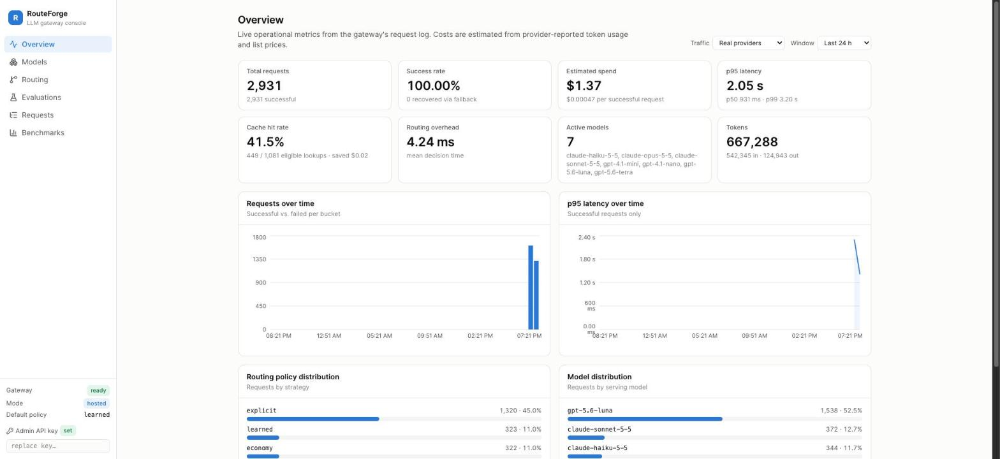
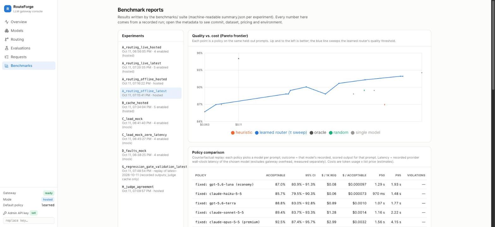

# RouteForge

**Quality-aware LLM gateway with adaptive routing, continuous evaluation and production
observability.**

RouteForge sits between applications and LLM providers behind an OpenAI-compatible API.
For every request it predicts, per candidate model, the probability of an acceptable
answer, then sends the request to the **cheapest model that clears a configurable quality
threshold** — with retries, fallbacks, circuit breakers, caching, rate limits, metrics,
traces and a dashboard around it. A versioned evaluation suite, a training pipeline for
the router and a benchmark harness measure whether it actually works.

The question this project answers with recorded experiments:

> *Can an intelligent model-routing system reduce LLM inference cost while keeping
> response quality and latency acceptable?*

On 161 held-out prompts, routing across GPT-5.6 and Claude 5.5 models end-to-end through
the gateway cut estimated cost by **89.1% [95% CI 82.1–93.9]** versus always using
Claude Opus 5.5, at **−1.2 pp** acceptable-answer rate **[−4.3, +1.9]** (98.6% quality
retention) and **28% lower p50 latency**. The full picture — including where routing
does *not* help — is in [docs/BENCHMARKS.md](docs/BENCHMARKS.md).



---

## What's in the box

| Area | What RouteForge does |
|---|---|
| **API** | `POST /v1/chat/completions` (JSON + SSE streaming), `GET /v1/models`; works with the official OpenAI SDKs. Unsupported parameters are rejected (HTTP 400), never silently dropped. |
| **Routing** | Fixed premium / economy, seeded random, rule-based heuristic, and a **learned router**: calibrated per-model P(acceptable) classifiers + expected-cost model + latency model, with safety margins and an out-of-distribution guard. Ablation variants ship as selectable strategies. |
| **Reliability** | Per-attempt timeouts under a request deadline, retries with full-jitter backoff capped by a **retry budget**, per-model **circuit breakers** that make failing models ineligible at routing time, fallback chains, per-key / per-model / global concurrency limits. |
| **Caching** | Exact-match Redis response cache keyed on tenant, resolved model, registry fingerprint, messages and all generation params; deterministic requests only by default; degrades to "miss" when Redis is down. |
| **Security** | HMAC-hashed API keys, admin role, Redis token-bucket rate limits, body-size limits, least-privilege Postgres role, no prompt storage by default, sandboxed execution of model-generated code. See [docs/SECURITY.md](docs/SECURITY.md). |
| **Observability** | Prometheus metrics (bounded labels), OpenTelemetry traces (Jaeger), Langfuse generations, async batched request log, event-loop-lag and GC-pause metrics, Grafana dashboard + alerts. |
| **Evaluation** | 840-case versioned benchmark (7 task types, group-wise splits, leakage check, oracle-validated answer keys), deterministic scorers, Docker-sandboxed unit tests, LLM judge with measured inter-judge agreement, bootstrap statistics, CI regression gates validated by power analysis. |
| **Dashboard** | React + TypeScript: overview, models, routing explainer, evaluations, request explorer, benchmark reports — all from live APIs, simulated data clearly labelled. |

## Architecture



Detailed component diagram, request path, failure semantics and a built-here-vs-library
table: [docs/ARCHITECTURE.md](docs/ARCHITECTURE.md). Rationale for every major choice:
[docs/DESIGN_DECISIONS.md](docs/DESIGN_DECISIONS.md).

## Tech stack

Python 3.12 · FastAPI · Pydantic · SQLAlchemy 2 (async) + Alembic · PostgreSQL 17 ·
Redis 7.4 · LiteLLM SDK (provider connectivity only) · scikit-learn / NumPy / pandas ·
prometheus-client · OpenTelemetry · Langfuse v4 SDK · React 19 + TypeScript + Vite +
Tailwind 4 + Recharts · Docker Compose · GitHub Actions · pytest · Ruff · mypy (strict) ·
Locust · hey. Every dependency is pinned to a release at least 14 days old
(supply-chain cooldown).

## Quickstart (no API keys needed)

Requirements: Docker Desktop, Python 3 (for the secrets helper).

```bash
git clone <this repo> routeforge && cd routeforge
python3 infrastructure/scripts/init_env.py   # writes .env with generated secrets (mock mode)
docker compose up --build -d                 # gateway :8000, dashboard :8080, postgres, redis
curl -s localhost:8000/ready
```

Open http://localhost:8080 and paste the admin key from `.env`
(`ROUTEFORGE_BOOTSTRAP_ADMIN_KEY`) into the sidebar. In mock mode every response,
latency and cost is **simulated** and labelled as such.

Observability stack (Prometheus :9090, Grafana :3000, Jaeger :16686):

```bash
ROUTEFORGE_OTEL_EXPORTER_ENDPOINT=http://jaeger:4318 docker compose --profile observability up -d
```

### Modes

Set `ROUTEFORGE_MODE` in `.env`, then `docker compose up -d backend`:

| Mode | Models | Needs | Notes |
|---|---|---|---|
| `mock` (default) | 4 simulated tiers | nothing | development, CI, demos, load tests |
| `replay-latest` | latest pool, recorded real outputs | `ROUTEFORGE_REPLAY_RECORDINGS_PATH` | zero-cost, deterministic, real content |
| `hosted-latest` | gpt-5.6-luna/terra, claude-haiku/sonnet/opus-5-5 | `OPENAI_API_KEY`, `ANTHROPIC_API_KEY` | **paid** |
| `hosted` | gpt-4.1-nano/mini, claude-haiku/sonnet-5-5 | same | earlier pool |
| `local` | llama3.2:1b, qwen2.5:3b/7b via Ollama on the host | `ollama pull …` | no per-token cost; laptop-speed inference |

For learned routing also set
`ROUTEFORGE_ROUTER_ARTIFACT_PATH=/app/router_training/artifacts/router-latest-2026-10-11`
and optionally `ROUTEFORGE_DEFAULT_STRATEGY=learned`. All settings:
[`backend/app/core/config.py`](backend/app/core/config.py) and
[`.env.example`](.env.example).

## Using the API

```bash
KEY=$(grep ^ROUTEFORGE_BOOTSTRAP_CLIENT_KEY .env | cut -d= -f2)

curl -s localhost:8000/v1/chat/completions \
  -H "Authorization: Bearer $KEY" -H "Content-Type: application/json" \
  -d '{"model": "routeforge-auto",
       "messages": [{"role": "user", "content": "Classify: \"Stocks rallied on Friday\" -> World, Sports, Business or Sci/Tech?"}],
       "temperature": 0,
       "routeforge": {"strategy": "learned", "quality_threshold": 0.85}}' -D - | grep -i x-routeforge
```

```python
from openai import OpenAI

client = OpenAI(base_url="http://localhost:8000/v1", api_key=KEY)
resp = client.chat.completions.create(
    model="routeforge-auto",                       # or routeforge-learned, routeforge-premium, or a concrete model id
    messages=[{"role": "user", "content": "Write a Python function that reverses a string."}],
    extra_body={"routeforge": {"quality_threshold": 0.8, "latency_budget_ms": 3000}},
)
print(resp.model, resp.model_extra["routeforge"])  # selected model, strategy, cost, cache, fallback
```

Every response carries `x-routeforge-{model,strategy,cache,cost-usd,fallback,trace-id}`
headers. `model` selects the policy: `routeforge-auto` (default policy),
`routeforge-<strategy>`, or a concrete model id (pinned: never silently replaced).

## How the learned router decides

For a request *q* and each eligible model *m* (circuit closed, context fits):

```
p_m     = calibrated P(acceptable | features(q), task(q), m)       # per-model logistic regression
cost_m  = in_tokens · price_in(m) + E[out_tokens | m, task] · price_out(m)
lat_m   = ttft_m + a_m · in_tokens + b_m · E[out_tokens]           # least squares prior × online EWMA

choose  argmin_m cost_m   subject to   p_m − margin_m ≥ τ   and   lat_m ≤ budget
else    the most likely-acceptable model within budget (quality over latency if none fits)
```

`margin_m` is the model's validation calibration error, plus an extra margin when the
request looks out-of-distribution. Training uses only the train split; selection and
margins use validation; the test split is reported once. Details and caveats (on this
benchmark most of the signal is *task identity*, not fine-grained difficulty):
[docs/EVALUATION.md](docs/EVALUATION.md).

## Results

All numbers are from recorded runs in `benchmarks/results/` (git SHA, dataset hash,
pricing, environment in each `summary.json`). Costs are list-price estimates from
provider-reported tokens. Total paid API spend for the whole project: **$9.36**.

| Benchmark | Result |
|---|---|
| **A. Routing, live, latest pool** (161 held-out prompts) | learned router vs always-Opus-5.5: **−89.1% cost [82.1, 93.9]**, **−1.2 pp quality [−4.3, +1.9]**, p50 1,096 vs 1,532 ms |
| A. Routing, offline replay | learned router Pareto-dominates always-Sonnet (−77.5% cost, same quality), always-Terra, random and the heuristic; beats always-Haiku by **+3.7 pp [+0.6, +7.5]**; cannot reach Opus's 92.5% |
| A. Earlier GPT-4.1 pool | −92.5% cost vs Sonnet at −2.5 pp, but **not** significantly better than always using Haiku 5.5 |
| B. Cache | warm hits p50 **10.9 ms vs 1,067 ms** uncached (real provider); 0 backend calls on hits |
| C. Capacity (zero provider latency) | 1 worker: **854 req/s** with learned routing (1,334 without routing), p95 35 ms, 0 errors up to 100 clients |
| D. Fault injection | **370/370** fault-affected requests recovered; ≤ 4 upstream calls per request; Redis and Postgres outages served with graceful degradation |
| E. Router overhead | learned decision **0.32 ms p50** in-process (from 362 ms before optimisation); +1.0 ms p50 end-to-end |
| G. Regression gate | 0/4 neutral changes blocked; blocks 100% of 10 pp regressions, warns on 100% of ≥ 3 pp, 0% false blocks |
| H. Judge reliability | GPT-4.1 vs Claude Fable 5.1: 91.7% agreement, κ = 0.31 (GPT-4.1 lenient); human labels not collected |



| Overview | Benchmarks |
|---|---|
|  |  |

## Evaluation and training pipeline

```bash
make dataset            # build routeforge-bench-v1 (public samples + synthetic JSON tasks)
make validate-dataset   # score every reference answer: 720/720 pass
make collect REGISTRY=config/models/hosted-latest.yaml   # every prompt × every model (paid, budget-capped)
make score  COLLECTION=latest-2026-10-11                 # deterministic scorers, sandboxed code, LLM judge
make train  COLLECTION=latest-2026-10-11                 # calibrated router artifact
make replay             # Benchmarks A + F (offline, free)
make regression-suite   # Benchmark G (free)
```

Paid tooling refuses to run without `ROUTEFORGE_PAID_BUDGET_USD` and stops before a call
would exceed it; every paid call is appended to `benchmarks/results/spend_ledger.jsonl`.
Dataset sources and licences, scorers, judge rubric, splits and leakage checks:
[docs/EVALUATION.md](docs/EVALUATION.md).

## Testing

```bash
make lint typecheck     # ruff + mypy --strict
make test               # 86 unit / API / failure-injection tests (SQLite + fakeredis, mock providers)
docker compose up -d postgres redis && \
  ROUTEFORGE_IT_PG_ADMIN_URL=postgresql+asyncpg://routeforge_owner:<POSTGRES_PASSWORD>@localhost:5432/postgres \
  make test-integration # 5 tests against real PostgreSQL (Alembic schema) and Redis
make coverage           # 82% line coverage of backend/app (unit + API suite)
cd frontend && npm test # 7 dashboard tests
```

CI (`.github/workflows/ci.yml`): lint + types, unit tests with coverage, integration tests
with Postgres/Redis service containers, the replay-based evaluation regression gate,
frontend type-check/test/build, Docker image builds, `pip-audit` and `npm audit`. CI
has no provider credentials and cannot incur model costs. (The workflow's commands were
run locally; it has not yet run on GitHub because this repository has no remote.)

## Limitations

- **One benchmark, 161 test prompts.** Confidence intervals are wide; differences of a
  few points are not resolvable. Task categories use fixed instructions, so task
  identification is trivially easy here and much harder on real traffic; prompts phrased
  unlike the benchmark are treated as out-of-distribution and escalated.
- **What the router learns** is mostly which model is good enough *per task*; lexical
  difficulty features added little. Within-task difficulty prediction would need more and
  more varied data, or embedding features.
- **Labels are imperfect.** NQ-open gold answers are noisy; summarization labels come from
  a lenient LLM judge (κ = 0.31 against a second judge); no human labels yet.
- **Costs are estimates** from list prices, not invoices. Latencies are from one laptop,
  one region, one week.
- Rate limits are shared via Redis, but breakers and concurrency limits are per process.
- Local (Ollama) mode is supported but was not benchmarked (the collection was stopped).
- Tool calling, multimodal inputs and `n > 1` are not supported (rejected explicitly).

## Future work

- Online learning from production feedback (thumbs, downstream success) with
  off-policy correction, instead of offline-only training.
- Embedding or small-model difficulty features, and per-tenant thresholds.
- Prompt-prefix caching awareness in the cost model (provider cache-read pricing).
- Routing over reasoning effort (same model at different effort levels) as candidates.
- Multi-replica breaker/latency state via Redis; Kubernetes manifests and HPA.
- Semantic cache with an explicit quality guard, evaluated with the same harness.

## Repository layout

```
backend/app/        gateway: api, core, routing, providers, reliability, caching,
                    telemetry, evaluation, analytics, services, models, schemas
backend/migrations/ Alembic migrations          backend/tests/  unit, api, integration
router_training/    dataset build + validation, collection, scoring, features, training,
                    artifacts/ (checksummed router models), data/ (recorded outputs, labels)
benchmarks/         A–H benchmark scripts, load tests, fault injection, results/
config/models/      model registries (mock, hosted, hosted-latest, replay-*, local)
frontend/           React dashboard            observability/  Prometheus, Grafana
infrastructure/     Postgres roles, env bootstrap          docs/  design, evaluation, benchmarks …
```
