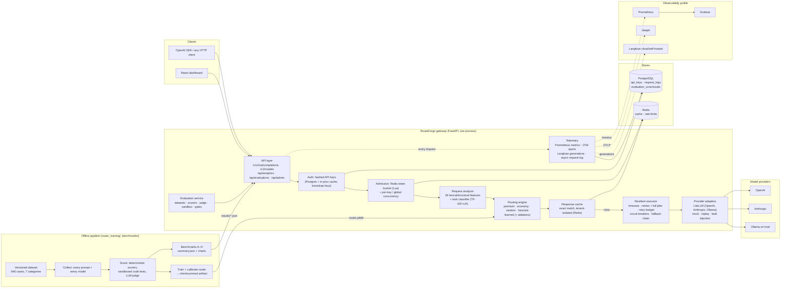

# Architecture

RouteForge is a **modular monolith**: one FastAPI service whose internal packages have
clean boundaries (routing, providers, reliability, caching, telemetry, evaluation,
analytics), plus PostgreSQL, Redis, an nginx-served dashboard and optional observability
services. Nothing here needs to be a separate microservice at this scale; the package
boundaries are where it would split if it ever had to.

## Request path

1. **API layer** (`backend/app/api/chat.py`) validates an OpenAI-compatible body. Unknown
   parameters are rejected with HTTP 400 instead of silently ignored.
2. **Auth** (`services/auth.py`): `Authorization: Bearer rf-…`. Keys are stored as
   HMAC-SHA256 digests; lookups are cached in-process for 60 s; bootstrap keys from the
   environment keep working during a database outage.
3. **Admission** (`services/gateway.py::_admit`, `reliability/rate_limit.py`,
   `reliability/concurrency.py`): Redis token bucket per key (atomic Lua script; degrades
   to a local bucket if Redis is down), then bounded waits for per-key and global
   concurrency slots.
4. **Analyze + route** (`routing/`): features are extracted once
   (`routing/features.py`), the strategy decides, and the decision is recorded with every
   candidate's scores. `model` selects the policy: `routeforge-auto` (default policy),
   `routeforge-<strategy>`, or a concrete model id (pinned, no fallback).
5. **Cache** (`caching/cache.py`): exact-match lookup keyed on tenant, *resolved* model,
   registry fingerprint, messages and adapted parameters. Only deterministic
   (`temperature=0`) requests are cached by default.
6. **Execute** (`reliability/executor.py`): per-model timeouts bounded by a request
   deadline; retries for retryable errors with exponential backoff + full jitter, capped
   by a global retry budget; circuit breakers make failing models ineligible; fallbacks
   follow the strategy's fallback chain. Streaming retries/falls back only before the first
   token.
7. **Respond + record** (`telemetry/`): OpenAI-shaped response plus `x-routeforge-*`
   headers (model, strategy, cache, cost, fallback, trace id); Prometheus metrics,
   OpenTelemetry spans and a Langfuse generation are emitted, and a row is queued for the
   asynchronous batched request-log writer.

## Component boundaries

| Package | Responsibility | Depends on |
|---|---|---|
| `core/` | settings, model registry, error taxonomy, logging, key hashing | — |
| `providers/` | one interface over LiteLLM, mock, replay; fault injection wrapper | core |
| `routing/` | features, task classification, cost/latency models, strategies, engine, artifact loading | core, providers (fingerprints) |
| `reliability/` | retry policy + budget, breakers, rate limiting, concurrency, executor | core, providers, telemetry |
| `caching/` | cache keys, eligibility policy, Redis cache | core, telemetry |
| `telemetry/` | metrics, tracing, Langfuse sink, request log writer, loop/GC monitors | models |
| `services/` | auth and the gateway orchestration (the only place that wires everything) | all of the above |
| `evaluation/` | datasets, scorers, sandbox, judge, runner, stats, regression gates, eval service | services (in-process client) |
| `analytics/` | SQL aggregations over the request log | models |
| `api/` | HTTP surface only | services, analytics, evaluation |
| `state.py` | composition root: builds every component from `Settings` | everything |

Offline code (`router_training/`, `benchmarks/`) imports the same `app` modules, most
importantly `app.routing.features.extract_features`, so training and serving compute
identical features.

## Built here vs. provided by libraries

| Capability | RouteForge code | Third-party |
|---|---|---|
| Provider connectivity, request/response translation | adapter, error classification, param adaptation | **LiteLLM** SDK (`acompletion`) |
| Routing strategies, learned quality-aware router, calibration margins, OOD guard, cost & latency models | **all original** | scikit-learn estimators, NumPy |
| Training pipeline (dataset build, collection, scoring, leakage checks, training, ablations) | **all original** | HF datasets-server (data source) |
| Retries, retry budget, circuit breaker, fallback chain, concurrency limits | **all original** | — |
| Rate limiting | token bucket Lua script + local fallback | Redis |
| Response cache | key design, eligibility policy, degraded mode | Redis |
| Evaluation: scorers, sandbox runner, judge rubric, bootstrap statistics, regression gates | **all original** | jsonschema, Docker (isolation) |
| Telemetry | metric design, request log, loop-lag & GC monitors | prometheus-client, OpenTelemetry SDK, Langfuse SDK |
| API | endpoints, compatibility policy, error envelope, SSE framing | FastAPI, Pydantic, Starlette |
| Persistence | schema, analytics queries, least-privilege roles | SQLAlchemy, Alembic, asyncpg |
| Dashboard | all views | React, Recharts, Tailwind |
| Load testing | workload + sweep runner | Locust |

RouteForge does **not** deploy the LiteLLM proxy server or use LiteLLM's router, caching,
retries or budget features; those are implemented here so they can be measured and
explained.

## API compatibility

Supported: `model`, `messages` (string or text parts; roles system/developer/user/
assistant), `temperature`, `top_p`, `max_tokens` / `max_completion_tokens`, `stop`,
`seed`, `presence_penalty`, `frequency_penalty`, `response_format` (`text`,
`json_object`, `json_schema`), `stream` + `stream_options.include_usage`, `user`, and the
`routeforge` extension object (`strategy`, `quality_threshold`, `latency_budget_ms`,
`cache`, `tags`).

Rejected with HTTP 400 (never silently dropped): `tools`/`tool_choice`, `n > 1`,
`logprobs`, image/audio content parts, and any unknown field.

Per-model parameter limits are explicit in the registry (`supported_params`). By default
a parameter a model cannot accept (e.g. `temperature` on Claude 5.5 models) is dropped and
reported in the `x-routeforge-dropped-params` header and `routeforge.dropped_params`;
`ROUTEFORGE_UNSUPPORTED_PARAM_POLICY=reject` turns this into an HTTP 400 instead.
`max_tokens` is always sent (capped), and models whose reasoning cannot be disabled have a
`min_max_tokens` floor so reasoning tokens cannot starve the visible answer.

## Failure semantics

| Failure | Behaviour |
|---|---|
| Provider timeout / 5xx / 429 / connection error / malformed body | retry same model (bounded, budgeted), then fall back; breaker opens on repeated failure |
| Provider 400 (bad request) | no retry, no fallback (another model would not fix it), HTTP 400 |
| Context window exceeded | fallback to a model with a larger window (ineligible models are skipped up front) |
| All candidates failed | HTTP 503/504 with a sanitized error; upstream messages are never forwarded |
| Failure after the first streamed token | SSE `error` event, stream ends; cannot be transparently recovered |
| Redis down | cache treated as miss (5 s backoff), rate limiting falls back to per-process buckets |
| PostgreSQL down | requests still served; bootstrap keys authenticate; request-log rows dropped and counted |
| Router artifact missing/corrupt | checksum fails → learned strategies disabled, heuristic used, error logged |
